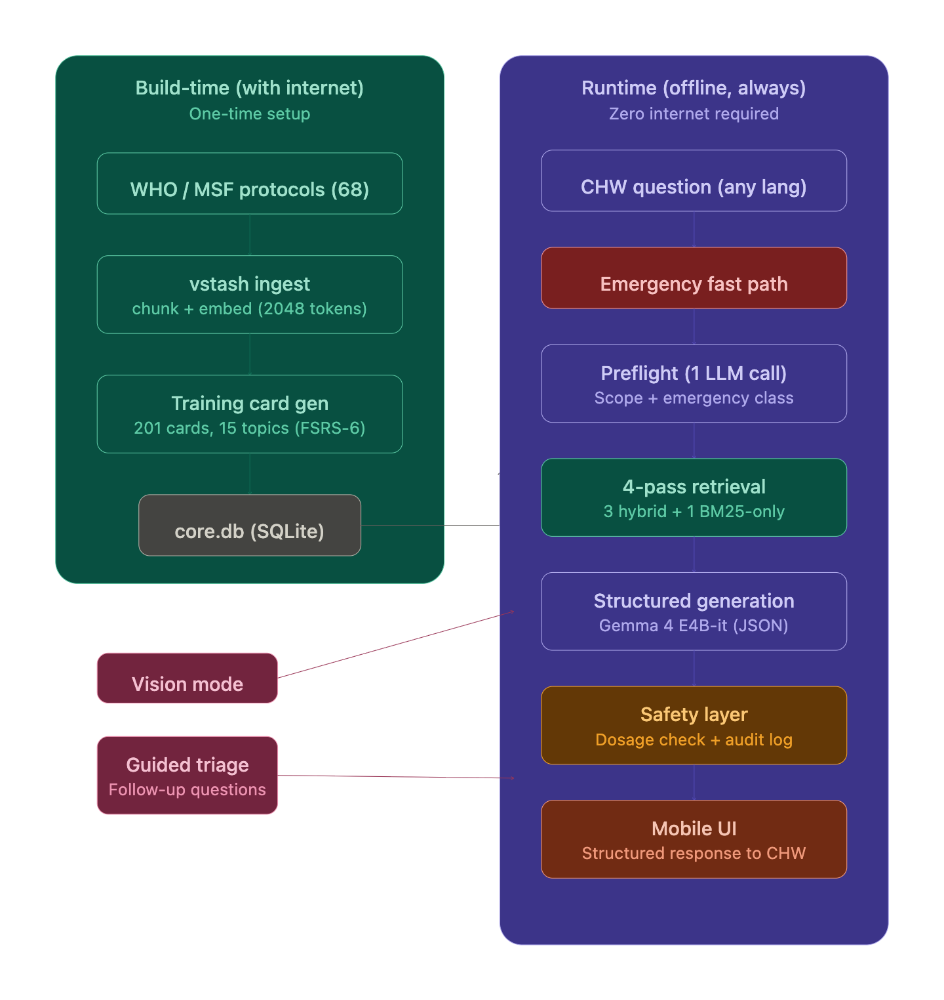

# MedLocal

**Offline clinical AI for community health workers.** Ask a question in any language, get a structured response with drug dosages, danger signs, and a traceable WHO protocol citation - no internet required.

Built for the [Kaggle Gemma 4 Good Hackathon 2026](https://www.kaggle.com/competitions/gemma-4-good-hackathon).
Impact tracks: Health & Sciences · Global Resilience · Digital Equity & Inclusivity.

> ⚠️ **Medical disclaimer** - MedLocal is a research and educational
> demonstration. It is **not** a medical device, not regulatory-approved,
> and not intended for clinical decision-making without supervision by
> a qualified healthcare professional. See [`LICENSE`](LICENSE) for the
> full disclaimer.

## Why This Exists

37% of the world has no reliable internet. The community health workers who would benefit most from clinical AI live and work in exactly that gap. Cloud-only tools are useless where they are most needed.

MedLocal runs entirely on-device - retrieval, reasoning, vision, safety checks - on a phone or laptop. One download, zero ongoing cost.

## What It Does

A CHW asks: *"Puedo darle aspirina a un niño de 4 años con fiebre?"*

MedLocal responds:
```
Condition: Fiebre
Assessment: Aspirina está contraindicada en niños menores de 12 años
            por riesgo de síndrome de Reye.
Actions:
  1. No dar aspirina a este niño.
  2. Administrar Paracetamol 10-15 mg/kg cada 6 horas.
  3. Pesar al niño para calcular la dosis exacta.
Source: WHO/UNICEF IMCI Guidelines
```

Every fact traces to a published protocol. The model never invents.

## Key Features

- **75+ WHO/MSF protocols** - pediatrics, maternal health, emergencies, infectious disease, toxicology, child protection
- **Anti-hallucination pipeline** - 9 safety layers including contraindication scan, controlled drug guard, dosage cross-check, allergy detection
- **Multilingual** - works in Spanish, French, Swahili, Portuguese, Hindi, Arabic, English
- **Vision mode** - photograph a wound, medication package, or document
- **Spaced repetition training** - 201 clinical training cards with FSRS-6 scheduling
- **99/101 (98%)** on a 15-category adversarial clinical safety benchmark

## How It Works

1. **CHW asks a question** in any language
2. **Pre-flight** classifies scope and emergency status
3. **Retrieval** searches 75+ local WHO/MSF protocols (4-pass FTS-boosted hybrid search)
4. **Gemma 4** reads the protocols and generates a structured response
5. **Safety layer** verifies dosages, blocks contraindications, catches controlled drugs

If the protocols don't cover a question, MedLocal says so and refers. No guessing.

## Quick Start

```bash
git clone https://github.com/stffns/medlocal.git
cd medlocal
pip install -e ".[dev]"

# Load Gemma 4 E4B in LM Studio (ctx=10000, temperature=0)
medlocal ingest data/core/protocols --profile core
medlocal serve
# Open http://localhost:8765
```

```bash
# CLI examples
medlocal consult-cmd "Niño de 2 meses con fiebre, ¿qué le doy?"
medlocal search "pesticide poisoning organophosphate"
medlocal protocol validate data/core/protocols/measles-who.md
```

## Architecture



The model never generates from general knowledge. It reads retrieved protocol text and formats a structured response. If retrieval confidence is low, it returns a referral instead of guessing.

**Technical deep-dive:** [ARCHITECTURE.md](docs/ARCHITECTURE.md) · [PIPELINE.md](docs/PIPELINE.md)

## Benchmarks

| Configuration | Score | Offline | Model |
|---|---|---|---|
| Gemma 4 E4B + MedLocal | **99/101 (98%)** | ✅ | 4B params, 6.3 GB |
| Gemma 4 E2B + MedLocal | validated | ✅ | 2B params, 4.4 GB |

15 categories: safety · emergency · clinical · dosage · hallucination · contraindication · multilingual · cross-lingual emergency · child protection · rabies · anaphylaxis · and more.

## Dependencies

| Package | License | Role |
|---|---|---|
| [vstash](https://github.com/stffns/vstash) | MIT | Local hybrid retrieval (vector + FTS5) |
| [Gemma 4 E4B/E2B](https://ai.google.dev/gemma) | Apache 2.0 | On-device LLM (loaded by LM Studio) |
| [FastAPI](https://github.com/fastapi/fastapi) | MIT | Web server |
| [py-fsrs](https://github.com/open-spaced-repetition/py-fsrs) | MIT | Spaced repetition |

Full dependency list and license audit in [docs/SOURCES.md](docs/SOURCES.md).

## Project Structure

```
medlocal/
  consult.py      # Consultation pipeline with safety layer
  preflight.py    # Scope + emergency classifier
  knowledge.py    # Protocol retrieval (vstash)
  safety.py       # Emergency detection, dosage check, allergy guard
  vision.py       # Visual triage, medication ID, document scan
  training.py     # FSRS spaced repetition
  api.py          # FastAPI endpoints
  web.py          # Mobile-first web UI
data/core/protocols/  # 75+ structured WHO/MSF protocols
tests/
  smoke_critical.py           # 22 critical cases (~5 min)
  benchmark_comprehensive.py  # 101 cases, 15 categories (~25 min)
```

## License

Apache 2.0. See [LICENSE](LICENSE).

---

*Hackathon writeup: [docs/HACKATHON-WRITEUP.md](docs/HACKATHON-WRITEUP.md) · Sources: [docs/SOURCES.md](docs/SOURCES.md)*
